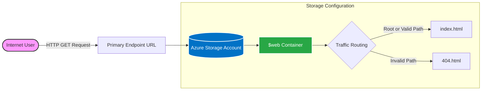

# Lab 01: Hosting Your First Static Website in Azure

## 1. Objective
In this lab, you will deploy your first public-facing resource in Azure. Instead of building and maintaining a complex virtual machine to host a simple website, you will use Azure Blob Storage. This introduces you to the concept of **PaaS (Platform as a Service)** and **Serverless hosting**, where you focus purely on the content, and Microsoft handles the underlying infrastructure.

## 2. Architecture Diagram



## 3. Prerequisites
- [x] Active Azure Subscription (Free Tier is fully supported).
- [x] Completed Week 1 Video Modules.
- [x] A basic text editor (Notepad, TextEdit, or VS Code).

## 4. Lab Variables (Naming Convention)
Use these naming conventions to ensure consistency throughout the deployment:
*   **Resource Group:** `rg-lab01-[yourname]`
*   **Location:** `East US`
*   **Storage Account Name:** `stlab01[yourname]` 
    * *Note: Storage account names must be globally unique across all of Azure, use only lowercase letters and numbers, and contain no special characters.*

---

## 5. Step-by-Step Instructions

### Phase 1: Create the Resource Group
1. Log in to the [Azure Portal](https://portal.azure.com).
2. Search for **Resource Groups** in the top search bar.
3. Click **+ Create**.
4. Under the **Basics** tab:
    *   **Subscription:** Select your subscription.
    *   **Resource Group:** Enter `rg-lab01-[yourname]`.
    *   **Region:** Select `(US) East US`.
5. Click **Review + create** -> **Create**.

### Phase 2: Create the Storage Account
1. Search for **Storage accounts** in the top search bar.
2. Click **+ Create**.
3. Under the **Basics** tab:
    *   **Resource Group:** Select `rg-lab01-[yourname]`.
    *   **Storage account name:** `stlab01[yourname]` (e.g., `stlab01jhante`).
    *   **Region:** `(US) East US`.
    *   **Performance:** `Standard`.
    *   **Redundancy:** `Locally-redundant storage (LRS)`. *(This is the most cost-effective option for labs).*
4. Click **Review + create**.
5. Wait for validation to pass, then click **Create**.
6. When deployment finishes (approx. 30 seconds), click **Go to resource**.

### Phase 3: Enable Static Website Hosting
1. On the left-hand menu of your Storage Account, scroll down to the **Data management** section.
2. Click on **Static website**.
3. Toggle the switch from "Disabled" to **Enabled**.
4. **Index document name:** Enter `index.html`.
5. **Error document path:** Enter `404.html`.
6. Click **Save**.
7. **CRITICAL:** Once saved, a **Primary endpoint URL** will appear (e.g., `https://stlab01jhante.z13.web.core.windows.net/`). Copy this URL and save it to your notepad. This is your website's public address.

### Phase 4: Create Your Website Files
You will create two distinct HTML files: one for the main page, and one to handle bad routing requests.

**1. Create the Main Page (`index.html`)**
Open your text editor, paste the following HTML code, and save the file to your desktop as `index.html`:

```html
<!DOCTYPE html>
<html>
<head>
    <title>My First Cloud Site</title>
    <style>
        body { font-family: sans-serif; text-align: center; margin-top: 50px; background-color: #f0f0f0; }
        h1 { color: #0078d4; }
    </style>
</head>
<body>
    <h1>Hello from the Cloud!</h1>
    <p>This site is hosted on Azure Blob Storage.</p>
    <p>Deployed by: [Your Name]</p>
</body>
</html>
```

**2. Create the Error Page (`404.html`)**
Open a new file in your text editor, paste the following HTML code, and save it to your desktop as `404.html`:

```html
<!DOCTYPE html>
<html>
<head>
    <title>404 - Not Found</title>
    <style>
        body { font-family: sans-serif; text-align: center; margin-top: 50px; background-color: #f0f0f0; }
        h1 { color: #d13438; }
    </style>
</head>
<body>
    <h1>404 - Packet Dropped</h1>
    <p>Looks like you hit a wall. The requested resource doesn't exist on this node.</p>
    <p>Contact your local IT Cloud Engineer.</p>
</body>
</html>
```

### Phase 5: Upload Content
1. Go back to your Storage Account in the Azure Portal.
2. On the left menu, click on **Containers** (under Data storage).
3. You will see a new container named `$web`. This was created automatically when you enabled the static website feature. Click to open it.
4. Click **Upload** at the top.
5. Browse your computer and select **both** your `index.html` and `404.html` files.
6. Click **Upload**. 
7. *Verification:* Ensure both files sit directly in the root of the `$web` container.

### Phase 6: Validation & Testing
1. Open a new browser tab or window.
2. Paste the **Primary endpoint URL** you copied in Phase 3 and hit Enter. You should see your "Hello from the Cloud!" message.
3. Next, test your custom error routing by intentionally typing a bad path at the end of your URL (e.g., `https://stlab01jhante.z13.web.core.windows.net/this-doesnt-exist`). 
4. Hit Enter. You should immediately see your custom `404 - Packet Dropped` page instead of a default Azure XML error.
5. **Congratulations!** You just deployed a resilient, serverless website.

---

## 6. Troubleshooting / Common Issues

*   **Issue:** "404 - The requested content does not exist" on the root URL.
    *   **Fix:** Check your file casing. Did you name the file exactly `index.html`? Azure Blob Storage is strictly case-sensitive. `Index.html` or `index.txt` will fail.
    *   **Fix:** Did you upload the files to the `$web` container? Uploading them to a standard container will not expose them to the web engine.
*   **Issue:** "Storage account name is already taken" during creation.
    *   **Fix:** Storage names operate on a global DNS namespace across all of Azure. Add random numbers to the end of your naming convention (e.g., `stlab01jhante99`).

## 7. Clean Up Resources
*Important: Always clean up unused resources to prevent billing leakage and keep your cloud environment tidy.*

1. Navigate to **Resource Groups** in the Azure Portal.
2. Click on `rg-lab01-[yourname]`.
3. Click **Delete resource group** at the top.
4. Type the exact name of the resource group to confirm the safety check.
5. Click **Delete**.
